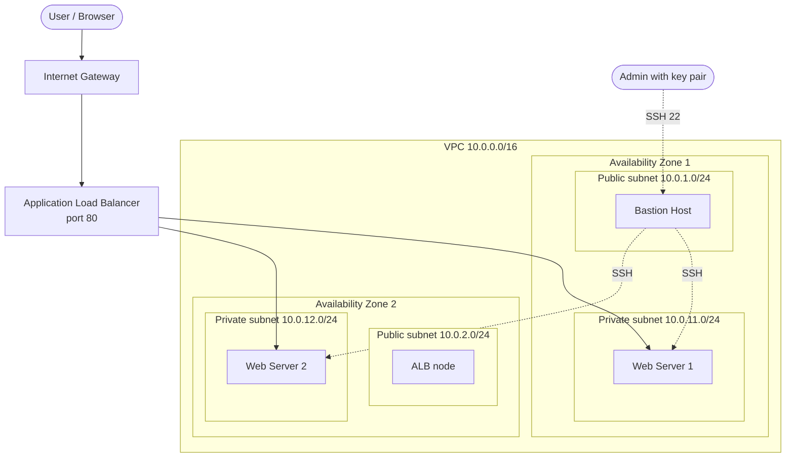

# Highly Available and Secure Multi-Tier Web Application Infrastructure on AWS WITH CFT


A complete, deployable AWS environment written as Infrastructure as Code. One CloudFormation template builds a custom VPC across **two Availability Zones** with **private web servers**, a **bastion host** for administration and an **Application Load Balancer** as the only public entry point for users. Two interactive web pages, one per server, make the architecture visible: they show which server answered, simulate failures and explain every component.


---

## Table of contents

1. [Overview](#overview)
2. [Architecture](#architecture)
3. [Key features](#key-features)
4. [How a request flows](#how-a-request-flows)
5. [Security design](#security-design)
6. [Repository structure](#repository-structure)
7. [Getting started](#getting-started)
8. [The web pages](#the-web-pages)
9. [Testing](#testing)
10. [Clean up and cost](#clean-up-and-cost)
11. [Known limitations and next steps](#known-limitations-and-next-steps)
12. [What this project demonstrates](#what-this-project-demonstrates)
13. [Author and license](#author-and-license)

---

## Overview

Running a website on one public EC2 instance is simple, but it has three weaknesses: one failure takes the site down, the server is directly exposed to the internet, and administration happens on a public server.

This project addresses each of them:

| Problem with a single public server | Solution in this project |
|---|---|
| One server or one data centre fails and the site is down | Two web servers in two Availability Zones behind a load balancer |
| The server is exposed to the internet | Web servers live in private subnets with no public IP |
| Admin login happens on the public web server | SSH only through a bastion host; web servers accept SSH only from the bastion |
| No automatic recovery | ALB health checks remove failed servers and re-add recovered ones |

The whole environment is created, and can be destroyed, with a single CloudFormation stack.

## Architecture



### Components

| Component | Count | Role |
|---|---|---|
| VPC (`10.0.0.0/16`) | 1 | Isolated private network |
| Public subnets (`10.0.1.0/24`, `10.0.2.0/24`) | 2, one per AZ | Host the ALB and the bastion host; route to the Internet Gateway |
| Private subnets (`10.0.11.0/24`, `10.0.12.0/24`) | 2, one per AZ | Host the web servers; no route to the internet |
| Internet Gateway | 1 | Door between the VPC and the internet |
| Route tables | 2 | Public (`0.0.0.0/0` to the IGW) and private (local only) |
| Application Load Balancer | 1 | Internet-facing, spans both public subnets, listens on port 80 |
| Target group | 1 | Both web servers; HTTP health check on `/` every 10 seconds |
| EC2 web servers (`t3.micro`) | 2 | Serve `/opt/website` from private subnets with `python3 -m http.server 80` |
| EC2 bastion host (`t3.micro`) | 1 | Admin entry point in public subnet 1 |
| Security groups | 3 | Firewalls for the ALB, the web servers and the bastion |

Details and design decisions are in [docs/architecture.md](docs/architecture.md).

## Key features

- **High availability**: servers in two Availability Zones; losing one server or one zone does not stop the site.
- **Defence in depth**: private subnets, security groups that reference each other, and a single admin entry point.
- **Self-healing traffic**: the ALB checks each server and routes only to healthy ones.
- **Infrastructure as Code**: the entire network is reproducible from one YAML template.
- **Interactive documentation**: the web pages double as a live explanation of the architecture and a failure simulator.

## How a request flows

1. The browser sends an HTTP request to the ALB DNS name on port 80.
2. The request enters the VPC through the Internet Gateway.
3. The ALB selects a healthy web server using round robin.
4. The web server security group accepts the connection because it comes from the ALB security group.
5. The private web server returns `index.html`; the response travels back through the ALB to the browser.

The user never sees a server address, only the ALB.

## Security design

| Layer | Control |
|---|---|
| Network | Web servers in private subnets, no public IP, no route from the Internet Gateway |
| Web traffic | Web server security group allows HTTP (80) only from the ALB security group |
| Private administration | Web server security group allows SSH (22) only from the bastion security group |
| Bastion access | Key-pair login; the bastion security group currently allows SSH from `0.0.0.0/0` (see [next steps](#known-limitations-and-next-steps)) |
| Exposure | The only internet-facing resources are the ALB (port 80) and the bastion (port 22) |

## Repository structure

```
aws-ha-multi-tier-web-infrastructure/
├── README.md                         Project overview (this file)
├── LICENSE                           MIT license
├── .gitignore                        Keeps key pairs and secrets out of Git
├── templates/
│   └── ha-multi-tier-infrastructure.yaml   CloudFormation template
├── web/
│   ├── README.md                     How the pages work and how to install them
│   ├── server1/index.html            Page served by Web Server 1
│   └── server2/index.html            Page served by Web Server 2
└── docs/
    ├── architecture.md               Design decisions, limitations and hardening
    ├── deployment-guide.md           Step-by-step deployment
    ├── testing.md                    Test plan with expected results
    ├── troubleshooting.md            Common problems and fixes
    └── images/
        ├── architecture.svg          Architecture diagram
        ├── social-preview.png        Repository social preview (1280x640)
        └── screenshots/              Screenshots used in this README
```

## Getting started

### Prerequisites

- An AWS account with permission to create VPC, EC2 and Elastic Load Balancing resources
- An EC2 key pair in the region you deploy to
- AWS CLI v2 configured (optional; the AWS Console works too)
- The template uses a fixed Ubuntu AMI ID (`ami-0c7632fb77f35db43`). AMI IDs are region-specific, so deploy in the region where this AMI exists or replace `ImageId` with an Ubuntu AMI from your region.

### 1. Deploy the stack

```bash
aws cloudformation create-stack \
  --stack-name ha-multi-tier-web \
  --template-body file://templates/ha-multi-tier-infrastructure.yaml \
  --parameters ParameterKey=KeyName,ParameterValue=<your-key-pair-name> \
  --region <your-region>

aws cloudformation wait stack-create-complete \
  --stack-name ha-multi-tier-web --region <your-region>

aws cloudformation describe-stacks \
  --stack-name ha-multi-tier-web --region <your-region> \
  --query "Stacks[0].Outputs" --output table
```

The stack outputs give you `WebsiteURL`, `BastionPublicIP`, `WebServer1PrivateIP` and `WebServer2PrivateIP`. The Console route is described in the [deployment guide](docs/deployment-guide.md).

### 2. Install the web pages

On first boot each server serves a one-line placeholder page from `/opt/website`. Replace it with the pages from this repository, copying through the bastion host:

```bash
scp web/server1/index.html web1:~/index.html
ssh web1 'sudo cp ~/index.html /opt/website/index.html'

scp web/server2/index.html web2:~/index.html
ssh web2 'sudo cp ~/index.html /opt/website/index.html'
```

The `web1` and `web2` aliases come from the SSH configuration in the [deployment guide](docs/deployment-guide.md).

### 3. Open the application

Open the `WebsiteURL` output in a browser:

```
http://<alb-dns-name>
```

Refresh a few times, or press **Send 10 real requests** on the page, and watch both servers answer.

## The web pages

Each server serves its own page, in its own colour, so you can see load balancing happen. Both pages are single self-contained HTML files with no external dependencies.

| Feature | What it shows |
|---|---|
| Server identity | Which server and Availability Zone answered the request |
| Interactive VPC diagram | Click any component to learn what it does |
| Traffic simulator | Packets travel User, Internet Gateway, ALB, then a server, with round-robin balancing |
| Failure lab | Stop a server or a whole Availability Zone and watch health checks and failover |
| Security demo | A direct attack on a private server is blocked; SSH works only through the bastion |
| Guided tour | A nine-step walkthrough for presentations |
| Real test | Sends 10 real requests through the ALB and charts which server answered |
| Deep-dive sections | Security groups, route tables, health checks, resources built, glossary and a quiz |

See [web/README.md](web/README.md) for details.

### Screenshots

The screenshots show the interactive lab on the pages, which simulates the ALB behaviour in the browser.

| | |
|---|---|
|  <br> **Each server shows who answered** |  <br> **Round-robin load balancing** |
|  <br> **A server fails and traffic moves to the other** |  <br> **A whole Availability Zone goes down** |
|  <br> **Direct access to a private server is blocked** |  <br> **Guided tour for presentations** |
|  <br> **Who can talk to whom** |  <br> **Health checks and failover** |
|  <br> **Why this design** |  <br> **Built-in quiz** |

## Testing

| Test | Expected result |
|---|---|
| Open the ALB DNS name | The page loads |
| Refresh repeatedly / real test | Both Server 1 and Server 2 appear |
| Look for public IPs on the web servers | None assigned |
| SSH to a web server through the bastion | Connects |
| `curl` a web server from the bastion on port 80 | Times out (only the ALB is allowed) |
| Stop the web server on one instance | Target becomes unhealthy after about 20 seconds; the site stays up on the other server |
| Start it again | Target becomes healthy and traffic is shared again |

The complete test plan is in [docs/testing.md](docs/testing.md).

## Clean up and cost

The ALB and EC2 instances are billed while they exist. Delete the stack when you are finished:

```bash
aws cloudformation delete-stack --stack-name ha-multi-tier-web --region <your-region>
```

Check the AWS Billing console afterwards to confirm that nothing is left running.

## Known limitations and next steps

This project is a learning and demonstration environment. These are the known gaps and how to close them (snippets are in [docs/architecture.md](docs/architecture.md#known-limitations-and-hardening)):

- **Bastion SSH is open to the world.** Restrict port 22 to your own IP through a template parameter.
- **The web server does not survive a stop and start.** It is launched by user data on first boot only. Run it as a `systemd` service so it comes back after a reboot.
- **The AMI ID is hard-coded and region-specific.** Look it up through an SSM public parameter instead.
- **No HTTPS.** Add an ACM certificate and a port 443 listener.
- **Fixed instances.** An Auto Scaling Group would replace failed servers and scale with load.
- **No outbound internet from private servers.** Add a NAT Gateway or VPC endpoints if they need updates.
- **No monitoring.** Add CloudWatch alarms for unhealthy targets and ALB 5xx errors.

## What this project demonstrates

- Designing a multi-tier network with public and private subnets
- Building for high availability across Availability Zones
- Least-privilege access with security group references
- Load balancing, target groups and health checks
- Secure administration through a bastion host
- Infrastructure as Code with CloudFormation
- Verifying a design by testing failure scenarios

## Author and license

Created by [Shaan027](https://github.com/Shaan027). | [LinkedIn](https://www.linkedin.com/in/your-profile-link)
